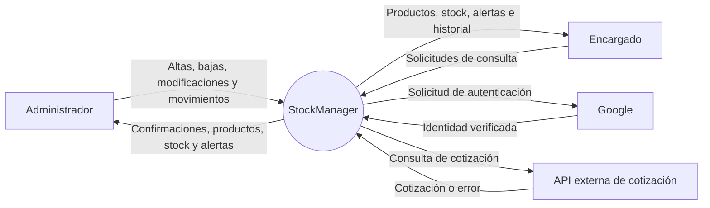

# Análisis del sistema — StockManager

## Objetivo

Desarrollar un sistema para administrar productos y mantener actualizado el inventario de una organización. Se busca facilitar las consultas, registrar los movimientos de stock y reducir errores en el control de existencias.

## Alcance

**Incluye:** productos, categorías, entradas, salidas, consultas, stock mínimo, historial, reportes y acceso mediante cuentas con roles.

**No incluye:** ventas, facturación, compras, gestión de proveedores ni funciones contables. Estos procesos podrían analizarse en una ampliación futura.

## Actores externos

- **Administrador:** registra y modifica productos, categorías, movimientos y usuarios; además, realiza consultas.
- **Encargado:** consulta productos, existencias, alertas y movimientos.
- **Google:** valida la identidad de los usuarios autorizados mediante OAuth.
- **API de cotización:** devuelve una referencia de compra/venta para la consulta del administrador.

## Diagrama de contexto

El sistema se representa como una única unidad. Además de los dos tipos de usuarios, intervienen servicios externos para el inicio de sesión y la consulta de cotización.

## Lista de acontecimientos principales

| Acontecimiento | Tipo | Respuesta del sistema |
|---|---|---|
| El administrador registra un producto | Externo (flujo) | Valida y guarda la información |
| El administrador modifica o desactiva un producto | Externo (flujo) | Actualiza su información o estado |
| El administrador o encargado registra una entrada de unidades | Externo (flujo) | Guarda el movimiento y actualiza el stock calculado |
| El administrador o encargado intenta retirar unidades | Externo (control) | Verifica que el stock alcance antes de guardar la salida |
| El encargado consulta el inventario | Externo (flujo) | Muestra los productos y sus existencias |
| Un usuario solicita el resumen del inventario | Externo (flujo) | Calcula el resumen y muestra las alertas de stock |
| Un usuario inicia sesión | Externo (flujo) | Valida las credenciales y habilita las funciones del rol |
| Un usuario autorizado selecciona Google | Externo (flujo) | Comprueba la identidad y vinculación con una cuenta activa |
| El administrador consulta cotización | Externo (flujo) | Solicita datos externos y muestra resultados o un aviso de error |

Las alertas de stock bajo se calculan cuando el usuario consulta el sistema; no se envían notificaciones automáticas.

## Modelo de datos

El sistema utiliza cinco tablas relacionadas: **roles, usuarios, categorías, productos y movimientos_stock**. Las relaciones principales son:

- Un rol puede corresponder a varios usuarios.
- Un usuario puede tener un correo Google vinculado; la identidad confirmada por Google se conserva en `google_sub`.
- Una categoría puede contener varios productos.
- Un producto puede tener varios movimientos de stock.
- Un usuario puede haber registrado varios movimientos.

Las vistas `vw_inventario`, `vw_resumen_inventario` y `vw_reporte_movimientos` facilitan las consultas sin duplicar los registros de stock.

## Trabajo por Sprints

Las necesidades del sistema se escribieron como historias de usuario en Trello, cada una con criterios de aceptación. Las tarjetas avanzan por las columnas Product Backlog, Sprint Backlog (To Do), In Progress, Code Review / Testing y Done.

[Tablero Trello](https://trello.com/b/D6cUCTrH/team-rcp-gestor-de-inventario-tp-integrador)
